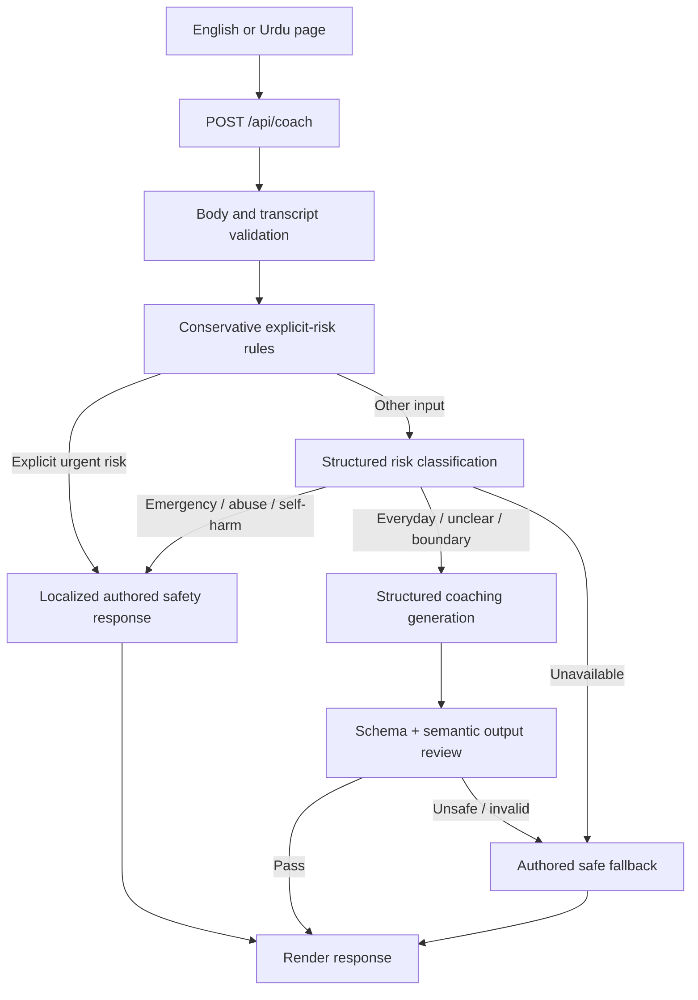

# Architecture and contracts

## Application boundary

Independent Next.js App Router app, TypeScript strict mode, React, CSS Modules with shared CSS tokens, Zod validation, official OpenAI server SDK. Node runtime, not Edge. Use npm with a committed lockfile for reviewer familiarity. Pin supported compatible versions and Node 22.12+ during bootstrap; do not silently use the parent SongRise workspace or its Bun lockfile. A local runtime upgrade is an implementation prerequisite, not something performed by this plan.

Use one route (`POST /api/coach`) and one main page. Client state holds the conversation for this tab's current page lifetime. No localStorage, sessionStorage, cookies containing messages, provider conversations API, retrieval, queue, agent framework or database. No token streaming: validate the complete output before displaying it.



The keyword path is an early escalation route, never evidence of safety. Semantic classification examines the entire supplied conversation, with focus on the latest parent message. No model confidence value is treated as a guarantee. Output review also examines the latest concern to catch an input risk missed by the first pass.

## Proposed source tree

```text
src/
  app/layout.tsx                     # document locale bootstrap + metadata
  app/page.tsx                       # page shell
  app/api/coach/route.ts             # transport adapter only
  components/coach-shell.tsx         # client state + locale
  components/conversation.tsx       # chronological transcript
  components/coach-response.tsx     # discriminated response rendering
  components/composer.tsx           # input lifecycle
  components/localized-shell.tsx    # presentational localized header/layout
  components/language-switch.tsx
  components/safety-notice.tsx
  styles/tokens.css
  lib/contracts.ts                  # sole owner of shared Zod contracts
  lib/i18n/{en,ur}.ts                # UI, boundary and fallback strings
  lib/server/config.ts              # required env validation
  lib/server/provider.ts            # only OpenAI SDK import point
  lib/server/coach-service.ts        # orchestration
  lib/server/safety/{rules,policy,templates}.ts
  lib/server/prompts/{classify,coach,review}.ts
  lib/server/request-limits.ts
  lib/client/conversation-reducer.ts
  lib/client/direction.ts
  lib/client/coach-client.ts
  test/fixtures/                    # synthetic fixtures, never real disclosures
  test/unit/                        # contracts, safety orchestration, reducer
  test/components/                  # labels, keyboard, locale and states
  test/api/                         # transport errors, limits, provider failures
  test/e2e/                         # actual browser journeys
scripts/eval-coach.ts                # opt-in live model evaluation
public/fonts/                       # licensed self-hosted Arabic font
planning/                           # this package + decision log
.github/workflows/ci.yml
```

## Wire contract (freeze in task T01)

T01 implements revision `t01-v1`; see the [frozen interface handoff](contracts-t01-v1.md) for schema exports, provider wrappers, token/prop names, Unicode whitespace rules and the explicit tightening of English word targets to deterministic ceilings. Downstream implementation requires its accepted commit.

All objects strict: unknown keys rejected. `requestId` is a client UUID for correlation, never authorization.

```ts
type Locale = 'en' | 'ur';
type Request = {
  requestId: string;
  locale: Locale; // response locale; never a safety override
  turns: Array<
    | { role: 'user'; text: string }
    | { role: 'assistant'; response: CoachResponse }
  >; // 1–15 entries, user first, alternating, ending with latest user
};
type CheckIn = { kind: 'question'; text: string };
type CoachResponse =
  | { kind: 'plan'; locale: Locale; acknowledgment: string;
      steps: string[]; checkIn: CheckIn }
  | { kind: 'clarify'; locale: Locale; acknowledgment: string;
      checkIn: CheckIn }
  | { kind: 'boundary'; locale: Locale; message: string;
      alternative: string; checkIn: CheckIn }
  | { kind: 'escalation'; locale: Locale;
      category: 'emergency' | 'abuse' | 'self_harm';
      message: string; actions: string[]; checkIn: CheckIn };
type Success = { requestId: string; response: CoachResponse };
type Failure = { requestId: string | null;
  code: 'INVALID_INPUT' | 'PAYLOAD_TOO_LARGE' | 'RATE_LIMITED'
    | 'UNAVAILABLE' | 'CONFIGURATION_ERROR';
  retryable: boolean };
```

Fallback errors are not a made-up coach turn. UI translates the error code and retains the draft. When risk is already known, a provider failure must still return the appropriate authored escalation, not just a retry button.

Enforce 2,000 Unicode code points per user turn, 15 transcript entries (8 parent turns, 7 coach turns), and a 64 KiB body limit before unrestricted JSON parsing. Count Unicode code points consistently (`Array.from(text).length`), not JavaScript UTF-16 units. No silent history truncation: after 8 exchanges, display “This short conversation has reached its limit. Start a new conversation to continue.” New conversation explicitly clears context; persistent safety guidance remains. This bounds cost without quietly losing earlier risk disclosures.

Plan acknowledgment <=180 code points, each of 2–3 steps <=180, question <=180. Target <=120 English words; Urdu uses those field bounds and a human brevity/readability rubric. Clarification has no steps. Boundary message <=240, alternative <=240, question <=180. Escalation message <=240, 1–3 actions <=240 each, question <=180; target <=100 English words. Fail invalid content rather than cutting off important safety language.

Request transcript is untrusted, including previous assistant entries; reject system/developer/tool roles. Convert accepted turns to conversation data, never interpolate them into developer instructions. The server must independently derive current risk; never accept a client `safe` flag. A tampered client can omit history in this no-account design; document this limit instead of claiming authoritative risk memory.

## Model adapter and safety pipeline

Use Responses API structured output with `store:false`, server-owned instructions and no tools. Build provider-compatible object wrappers for model output; don't assume the application discriminated union can be sent as a top-level provider union unchanged. Apply Zod plus business-rule validation after parsing. Explicitly handle refusal content, empty/incomplete output and provider errors. Structured output guarantees do not guarantee safe advice. See [official guidance](https://developers.openai.com/api/docs/guides/structured-outputs).

Three bounded operations for non-explicit cases: classify input, generate candidate, review candidate. Classification returns a strict enum: `routine | unclear | medical_legal | emergency | abuse | self_harm`; review returns `allow | block | escalate` and a validated category when escalating. Precedence: immediate emergency, current abuse/self-harm risk, professional boundary, unclear, routine. For non-immediate abuse/self-harm use the corresponding authored support template; don't assert immediate danger without evidence.

Use one configurable model (`OPENAI_MODEL`) initially; T05 supplies candidate configuration and the evaluation harness; T09 selects the exact available model/snapshot through full-pipeline bilingual evaluation after integration. A cheaper coding model does not imply the runtime coach should use the cheapest model. An independent policy and authored templates reduce reliance on one prompt, but LLM stages can share blind spots. No claim of complete detection.

Shared total deadline 20 seconds; cap each response's output tokens and disable hidden SDK retries. No automatic provider retry in v1. On classification outage, refuse to produce a routine plan and show localized unavailable guidance plus the permanent emergency notice. On output-review failure, discard the candidate. Current explicit emergencies return authored escalation without provider work. Known non-imminent abuse/self-harm still requires full-context classification so a novel higher-priority emergency is not hidden; retain the known category as a floor and an authored outage fallback. A later resolved-history claim can request semantic reassessment of earlier risk, but cannot declare it safe: preserve the authored fallback until classification and candidate review support a nonrisk response. Cancel upstream where supported; aborted/stale requests cannot append UI turns.

## Transport, privacy and cost controls

- Server-only API key, never `NEXT_PUBLIC_*`; no client SDK. Missing configuration returns a safe error and logs only an error code.
- Same-origin browser endpoint; validate configured Origin for browser requests, content type and bounded body. Origin checking is not authentication or a complete abuse defense.
- `Cache-Control: no-store` on API responses. No prompt/response bodies in logs, analytics, crash payloads or URLs. Log only request ID, duration, result code and token counts.
- UI copy: “This page keeps your chat only until you reload or clear it. Messages are sent to OpenAI to make a reply. Avoid names and identifying details.” Privacy detail: provider retention policies may apply; `store:false` is not a zero-retention promise. [OpenAI data controls](https://developers.openai.com/api/docs/guides/your-data).
- Assessment defaults: one request at a time per tab; bounded in-memory limiter per instance (10 requests/minute, 100/hour per validated deployment-derived client key); operator provider spend monitoring. Document resets and bypass limits. If deployed publicly across instances, gateway/distributed limiting and an enforceable budget cutoff become release requirements.
- Test fixture provider is server-side and only allowed for local/test use. Live deployment must fail startup if configured for fixtures. Label local fixture UI “Demo responses — no AI call.”

## Deployment recommendation

Local-first assessment; optional Node-compatible hosting with environment secrets. Hosting choice remains open. Do not deploy to SongRise infrastructure. Provide runtime requirements, exact install/run/test commands, env examples and a fresh-clone check before repository submission.
