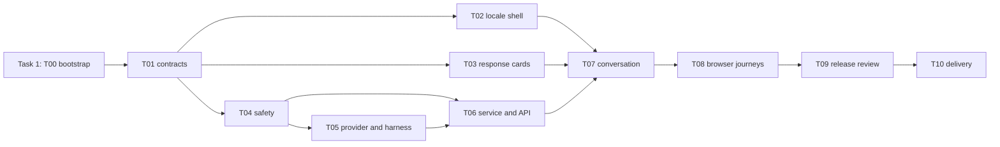

# Session directive and project direction

Latest owner scope, 18 November 2026: final holistic code review, README polish and coverage of the supplied assessment statement. That statement requests a GitHub repository link and short run README; it does not require a video or deployment. The [final overview](evidence/final-overview.md) records feature coverage, fresh checks and existing live-quality/human-review limits. This request authorizes the documentation/reproducibility subset of T10 alongside T09 review; it does not establish safety/release acceptance. Product safety policy/prompts/model configuration remain unchanged in this pass. Git/main and remote were verified at `8baf9e4`; this pass is uncommitted until actual approval/commit.

Effective 18 November 2026. Applies to upcoming ParentPause sessions. The owner's latest instructions take precedence. This document reconciles the earlier blueprint with the actual source, repository and tracker; historical evidence remains dated evidence.

## Direction

On 18 November 2026 the owner explicitly authorized source publication to `https://github.com/navneet-p-lab/parent-pause.git`, independently of the remaining T09 release gates. After owner browser sign-in, source history through `a404500` was successfully pushed with main tracking origin/main. Latest evaluation/publication evidence is prepared for the required owner commit widget and subsequent push; inspect Git for its actual outcome. No deployment, release approval, video or email is included in this authorization.

Deliver the assessment demo already agreed with the owner: a small Next.js/OpenAI parenting coach in English and Urdu, with Roman Urdu safety inputs, brief practical responses and exactly one question as a check-in. Keep the warm, single-column design and explicit locale choice. Region-neutral safety guidance must never infer country from language.

Keep messages in page memory. Do not add accounts, a database, reminders, streaming, uploads, tools or durable history to this scope. Provider output is validated plain text. Emergency, abuse and self-harm routes use authored responses; classification/output review failures cannot become ordinary coaching. Follow the [product](01-product.md), [architecture](03-architecture.md), [design](02-design.md) and [safety policy](05-safety.md).

## Verified starting point

The independent Git root is this project folder. Earlier SongRise nesting statements describe the original environment and are superseded for current operations. Do not copy or modify any unrelated repository, credentials or history. Inspect remotes before any future publication; no push/deployment is authorized by this directive alone.

The implemented app remains T00's static English shell with no input collection, API route, provider or localization. T00 is accepted at `2097a2c`. T01 adds strict schemas, bilingual synthetic fixtures and the [t01-v1 interface handoff](contracts-t01-v1.md); see [T01 evidence](evidence/t01-contracts.md) and Git/tracker for its approval/commit outcome. Planning includes a bilingual interactive prototype and 35 synthetic safety cases; neither establishes implemented coaching. The [bootstrap reassessment](evidence/session-reassessment.md) remains dated evidence.

All 11 packets T00–T10 have local native Task cards under the `parentpause` tag. Task 1 means **T00 bootstrap**, not T01 contracts. The board is local: team sync and collaborative body storage are unavailable. Portable packets remain the cross-machine source; never publish local tracker keys in commits or reviewer artifacts.

## Begin each session

1. Read this directive, the selected [packet](tasks/README.md), its prerequisites and latest evidence. Check Git root, branch, status and latest commits before editing. Preserve existing work.
2. Query the tracker including closed items before creating cards. Match packet titles to avoid duplicates. Call work radar for the selected item and inspect linked sessions before claiming it. Link the session and set In Progress.
3. Honor dependency completion and file ownership. T01 starts after bootstrap acceptance and the approved baseline commit. Freeze shared schemas, token names and response props before T02/T03/T04. The integrator owns manifests/configuration after T00.
4. Select Node 22 from the documented runtime and check versions. Use the project lockfile and local npm configuration. Never repair failures by bypassing engines or peer constraints.
5. State scope and assumptions, implement the packet and verify its behavior. Resolve routine choices autonomously. Ask only when missing information materially blocks the authorized work. Do not silently start another packet.

## Execution sequence

T02/T03 and the safety/backend track can proceed independently after T01; use this as dependency guidance. Delegation/concurrent agent execution requires an explicit request or applicable instructions, plus isolated worktrees and narrow ownership. Through T01, delegation covered read-only technical review; the later T02–T04 implementation used three isolated worktrees as recorded in the parallel evidence.

T05 completes the deterministic adapter/harness. T09 performs full-pipeline live evaluation and final model selection after T06 integration; do not introduce a circular dependency. Native Urdu and human safety reviews remain release gates.

## Verification and acceptance

Use [the setup commands](../README.md) and [test strategy](06-testing.md). Current baseline: lint, generated-route typecheck, component smoke, build and 10 Chromium/WebKit shell cases. Build before E2E. Unit/API commands intentionally fail while suites are absent; conditional CI deferral is only for bootstrap. Require behavioral suites as their code lands and update CI if ownership paths change. Never use `--passWithNoTests`.

Test the relevant regression when fixing a behavioral gap. Record exact commands, exit results, suite counts and environment. Distinguish fresh cached installs from uncached clone/hosted CI, fixture behavior from live inference, automatic accessibility checks from manual review, and self-review from independent review.

The outstanding picomatch development-tool advisory is recorded in [bootstrap review](evidence/t00-review.md). Recheck before dependency changes; do not force downgrade or invent a patched release. Runtime audit and full audit are separate checks. This limitation does not establish readiness for public hosting.

## End each session

1. Append to [the AI log](07-agent-log.md): owner request, input revision, actual executor/model if exposed, implementation, consequential failures/rework, exact verification, unresolved risks and handoff. Keep secrets, private reasoning and real parent disclosures out of evidence.
2. Update the selected packet, evidence and [reviewer handoff](10-reviewer-handoff.md) when the verified state changes. Name the next ready packet and gates. Preserve earlier results as historical snapshots rather than silently rewriting them.
3. Move verified work to In Review before commitment. When asked to commit, inspect session-edited files and Git status, review all portable changes, then use Nimbalyst's commit proposal. Include all uncommitted session work and the owner-requested earlier work in scope. Exclude ignored build/dependency/session output and secrets. The commit widget requires the owner's interaction; do not replace it with command-line commit.
4. After an actual commit, read its SHA and check status. Link the SHA and close the accepted card; local-only keys cannot go in public commit messages. A successful baseline commit is bootstrap integration approval, not independent safety approval. Update session commit tags and phase accurately.

## Next session

T01 is accepted at `47728e2`. T02 locale shell, T03 response cards and T04 safety routing have now been implemented in isolated worktrees and technically reviewed; see [parallel implementation evidence](evidence/t02-t04-parallel.md). Confirm their actual approved commit and tracker status before starting dependent work; finish the commit workflow if pending. **T05 provider adapter and deterministic evaluation harness** is next after T04 acceptance, then T06 service/API and T07 conversation-page integration. Use the frozen [t01-v1 interface](contracts-t01-v1.md) and T04's policy/prompt handoff. The product page remains an unconnected English preview until T07. The integrator owns shared contracts, package/configuration and page wiring. Native Urdu/human safeguarding review remains a release gate.

## Latest T05 handoff — 18 November 2026

T02–T04 acceptance is confirmed at `a35f8c6` with closed native cards. T05 now implements server configuration, the bounded server-only provider adapter, coaching prompt and opt-in diagnostic/evaluation harness. See [T05 evidence](evidence/t05-provider.md) and the [provider/evaluation interface](contracts-t05-v1.md). Check actual Git/native commit acceptance before starting **T06 service/API**, then T07. The page remains the English preview; no endpoint, live model evaluation, final model choice or native/human safety approval is claimed. Current direct-provider diagnostics cannot supply accepted follow-up setup replies; T09 must use the integrated pipeline seam.

## Latest T06 handoff — 18 November 2026

T05 acceptance is confirmed at `0b58067`. T06 now implements safety orchestration, the bounded Node API, instance limits, local/test fixture sessions and production fixture startup rejection. See [T06 verification](evidence/t06-service.md) and [service/transport handoff](contracts-t06-v1.md). Confirm actual Git/native commit acceptance before starting **T07 conversation integration**. The page remains the unconnected English preview, while POST /api/coach exists separately. The safety revision is `t06-safety-v2` after a narrow explicit abuse-declaration repair. No paid evaluation, final model choice, native Urdu/human safeguarding approval or public hosting is claimed. The limiter is per instance and defaults to one shared local bucket; public gateway/distributed limits and a budget cutoff remain requirements.

## Latest T07 handoff — 18 November 2026

T06 acceptance is confirmed at `7003017`. T07 now connects the bilingual composer, transcript and memory-only lifecycle to the real endpoint, including explicit fixture disclosure, drafts/retry/cancel/clear, stale-response suppression and context limits. See [verification](evidence/t07-conversation.md) and [T08 handoff](contracts-t07-v1.md). Check actual Git/native commit acceptance before starting **T08 maintained browser journeys**. The app is no longer the static preview. The page derives only a nonsecret fixture flag at request time; no key/provider code is client-side. Fixture endpoint smoke is not live evaluation or native/human approval. Keep production fixture prohibition and public-hosting limits.

## Latest T08 handoff — 18 November 2026

T07 acceptance is confirmed at `197a28a`. T08 adds maintained real-network Chromium/WebKit journeys and controlled server-side fixture sessions, wired into CI. See [plan](evidence/t08-browser-plan.md) and [browser validation](evidence/browser-validation.md). The original Next route is exercised directly for default fixtures/authored risk; controlled scenarios use the exported real handler/service and injected sessions. No product fixture selector or safety/provider contract changed. Check actual Git/native commit acceptance before **T09 release review**. Live full-pipeline evaluation needs explicit candidates/configuration and an approved spend envelope. Native Urdu/human safeguarding, real assistive technology, physical-device/mobile-keyboard and browser-zoom checks remain pending. No hosting/publication approval is implied.

## Latest T09 preparation handoff — 18 November 2026

T08 acceptance is confirmed at `17befd3`. T09 now has an integrated service evaluation CLI (`npm run eval:release`, dry-run by default), truthful route/category/content-review reporting, failed-stage usage/cost-estimate accounting and a separate technical audit. See [plan](evidence/t09-release-plan.md), [model-evaluation readiness](evidence/model-evaluation.md) and [technical release review](evidence/release-review.md). Verify the preparation's actual commit in Git; a preparation commit does **not** complete T09 or unblock T10. No key/model or paid spend envelope was supplied; no live call, final model choice or human/native/manual approval occurred. Resume T09 with explicit candidates, project-local key configuration and approved spend envelope, then actual output/native/safeguarding/manual review. Current six held-out cases are AI-authored. Preserve product policy/transport/fixture-production restrictions and public-hosting requirements.

## Latest T09 live attempt — 18 November 2026

Owner configured the ignored project-local key and explicitly authorized evaluations within **US$3 total**. The first guarded Luna/Terra comparison stopped after 2/166 attempts on HTTP429 `credit_balance_exhausted`: one accepted English Luna plan; Terra unavailable with missing usage. No more paid calls were attempted. **US$0.017736 conservatively reserved; at most US$2.982264 remains in this authorization.** The new guard is per invocation; subtract prior reservations before any resumed run. See [live evidence](evidence/t09-live-evaluation-2026-11-18.md) for command/artifact, rate provenance, instrumented-latency limits and authored EN/UR browser verification. Credits, full comparison, final model selection and human/native/manual approval remain pending; T09 stays In Progress and T10 gated. No public deployment or credential UI was added. Check current Git status before editing; this session's changes are uncommitted until actual owner acceptance.

## Latest T09 funded comparison — 18 November 2026

Owner topped up credits; **the original US$3 total remains binding**. All 166/166 model attempts completed after provenance-checked resumptions and call-weighted pacing. Luna 79/83 and Terra 81/83 expected routes; five review-blocked ambiguity responses and one first-pass rate-limit failure remain failures. Separate Terra Urdu recovery passed without replacing the failed record. Luna also inserted inappropriate crisis framing into an idiom despite a route pass. See [full comparison and next repair](evidence/t09-model-comparison-2026-11-18.md). **Combined reservations US$1.615455; at most US$1.384545 remains in this authorization.** Never reset a new invocation to US$3. Known-token estimate US$0.1102685 is incomplete billing evidence, not an invoice. Terra is the stronger next-review candidate in this sample; final model choice and release remain gated on ambiguity-response repairs plus human/native/manual checks. Product policy/prompts/provider limits/corpora were not changed; do not silently weaken them to make evaluation green. New evaluator changes are self-reviewed; final 500/500/typecheck/lint/diff pass. T09 stays In Progress; T10 remains gated, and no commit/publication/deployment occurred. Preserve the uncommitted work and earlier dated snapshots.
