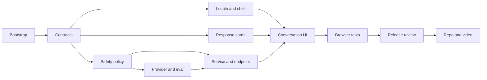

# Work packets for smaller coding models

The 11 native Kanban cards have been created. See the [Kanban execution guide](KANBAN.md) for parallel lanes, workflow and local-sync limitations.

T00 bootstrap acceptance is reverified for the approved baseline commit; see [current reassessment](../evidence/session-reassessment.md). Git/native board records the actual integration outcome. Read the [session directive](../09-session-directive.md) before claiming work. No delegated implementation agents have run. The remaining packets are future handoffs. Use one focused agent session per packet, with narrow file ownership and explicit acceptance tests. A stronger lead reviews contracts and safety-sensitive work. Native Urdu and safeguarding review remain human gates. Concurrent/delegated execution requires explicit authorization or applicable instructions; these packets alone do not start agents.

## Execution order



After T01 freezes the interfaces, T02 and T03 can run independently of the safety/backend track. T01 freezes token names and presentational props before parallel UI work. T04 then T05 then T06 should integrate sequentially; full-pipeline live evaluation belongs to T09, so it does not create a circular T05/T06 dependency; do not parallelize mutations of shared contracts/config. T07 is the main integration point. The lead handles dependency/config changes after T00.

| Packet | Scope | Dependencies |
|---|---|---|
| [T00](T00-bootstrap.md) | Bootstrap isolated app and test runners | None |
| [T01](T01-contracts.md) | Freeze request/response schemas and fixtures | T00 |
| [T02](T02-localized-shell.md) | Build responsive shell and locale system | T01 |
| [T03](T03-response-cards.md) | Render structured response families | T01 (token names/props frozen; parallel with T02) |
| [T04](T04-safety-routing.md) | Implement authored safety routes and policy | T01 |
| [T05](T05-provider.md) | Implement model adapter and evaluation runner | T01; T04 prompt contracts |
| [T06](T06-service-api.md) | Wire server policy and bounded endpoint | T04 and T05 |
| [T07](T07-conversation-ui.md) | Connect composer and conversation lifecycle | T02, T03 and T06 |
| [T08](T08-browser-tests.md) | Add cross-browser journeys and accessibility checks | T07 |
| [T09](T09-release-review.md) | Review bilingual safety and complete evidence | T08 plus live provider configuration |
| [T10](T10-delivery.md) | Prepare repository, README and video handoff | T09 release gate |

## Shared rules to include in every assignment

1. Keep work inside this independent project; do not modify SongRise, reuse its credentials, deploy its services or change its Git history.
2. Read only the task's needed source and the planning contracts. If more than one packet is required, hand the problem back for rescoping rather than growing the task silently.
3. Add tests with the behavior. Use the fake provider by default; no paid model calls unless the live-evaluation task has configuration and an approved cost envelope.
4. Do not weaken a safety rule or acceptance test to make a run green. Raise contract/policy questions to the lead with a concrete counterexample.
5. Do not edit another agent's files. The lead integrates handoffs; use isolated branches/worktrees in this independent repository if executing concurrently.
6. Return a short patch summary, exact verification commands/results, unresolved risks and a log entry. No claims of a test run, deployment, native review or model evaluation without evidence.
7. Record actual executor/model when known; do not infer hidden model identity, token use, time saved or cost. Redact secrets and use synthetic parent examples.

## Handoff template

```text
Packet:
Executor/model (or unknown):
Input/contract revision:
Files changed:
Tests run + outcome:
Evidence paths:
Decisions/deviations:
Known limitations:
Reviewer + result:
Next packet:
```

The estimates are rough focused-work ranges and exclude environment repair, model access, publication approval and reviewer availability. Start with small packets; split further if an agent repeatedly needs cross-cutting changes. Do not spend a smaller model's context on the entire repository when its task only touches a renderer.
